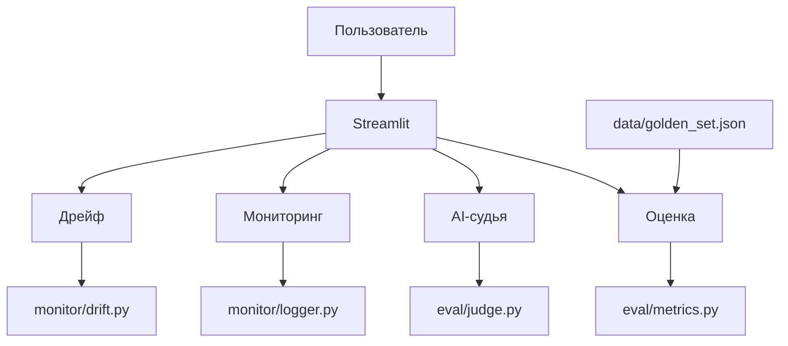

# RAG-Eval-Monitor

Конвейер оценки и мониторинга RAG-систем (демо-режим, без API-ключей).

## Что это

Демонстрирует полный цикл инженерии оценки для RAG:

- Метрики качества: точность/полнота контекста, exact match, token F1, согласованность фактов.
- AI-судья (демо на TF-IDF) для оценки релевантности и обоснованности.
- Срезы данных (data slices) для поиска проблемных мест.
- Мониторинг запросов с логированием в JSONL.
- Обнаружение дрейфа (drift detection).

## Стек

Python 3.12, Streamlit, pandas, numpy, plotly, scikit-learn (TF-IDF). Без API-ключей.

## Структура

- app.py — Streamlit-дашборд
- eval/metrics.py — метрики оценки
- eval/judge.py — AI-судья на TF-IDF
- eval/test_sets.py — генерация срезов
- monitor/logger.py — логирование
- monitor/drift.py — обнаружение дрейфа
- data/golden_set.json — эталонный набор
- requirements.txt

## Запуск

python3 -m venv venv
source venv/bin/activate
pip install -r requirements.txt
streamlit run app.py

Открой http://localhost:8501 в браузере.

## Оценка

Проект протестирован на 6 эталонных примерах. AI-судья на TF-IDF работает без внешних API.

| Тест-кейс | Результат |
|---|---|
| Идеальный ответ | 5/5 метрик > 0.9 |
| Случайный ответ | 4/5 метрик < 0.5 |
| Пустой ответ | 5/5 метрик = 0.0 |
| Срез «Короткие вопросы» | 6 из 6 |
| Дрейф длины | обнаружен |
| AI-судья | работает |

**Что не тестировалось:** реальная LLM, реальная RAG-система, многопользовательская нагрузка.

## Архитектура

